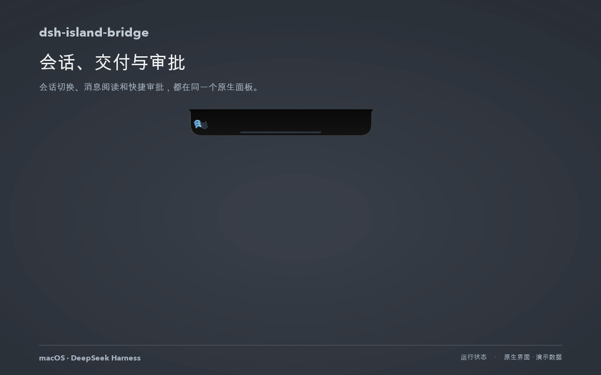
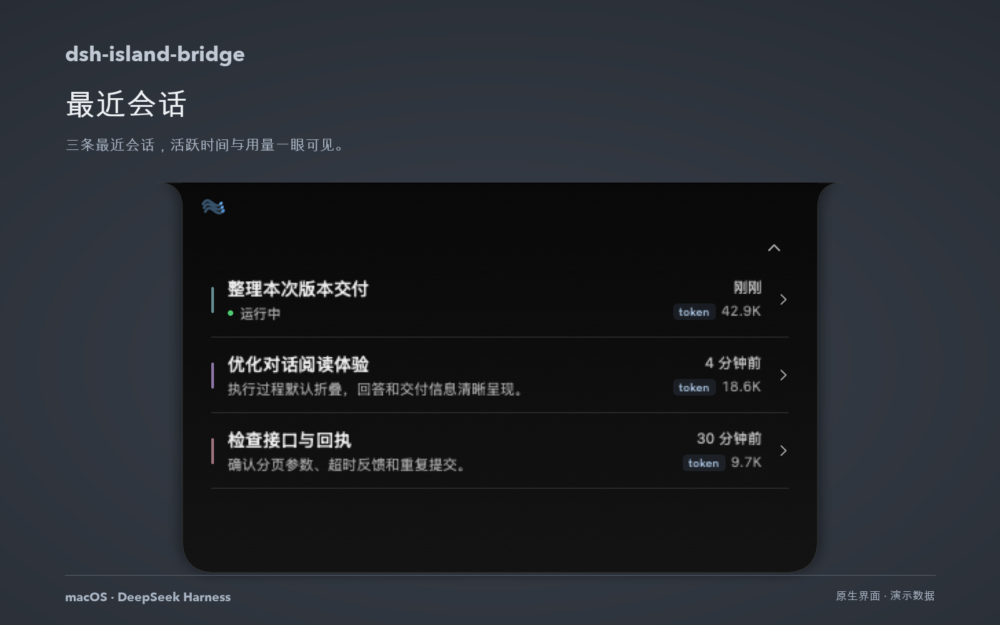
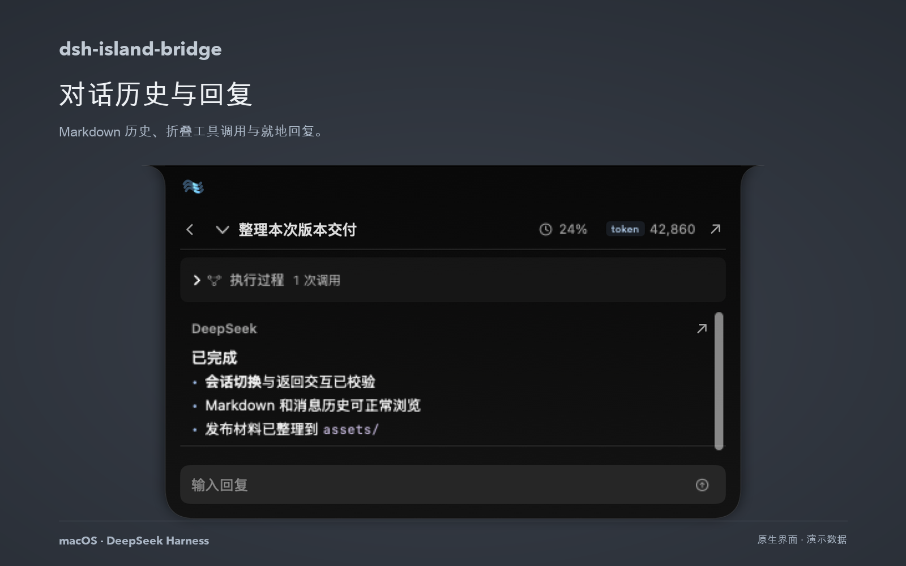
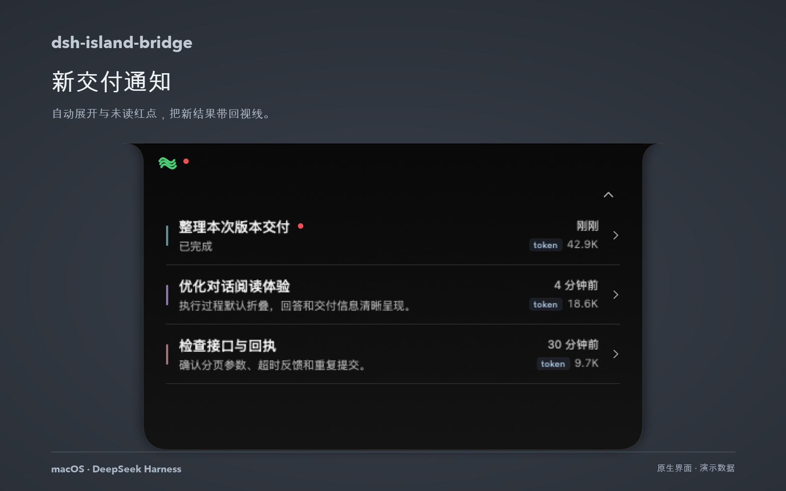
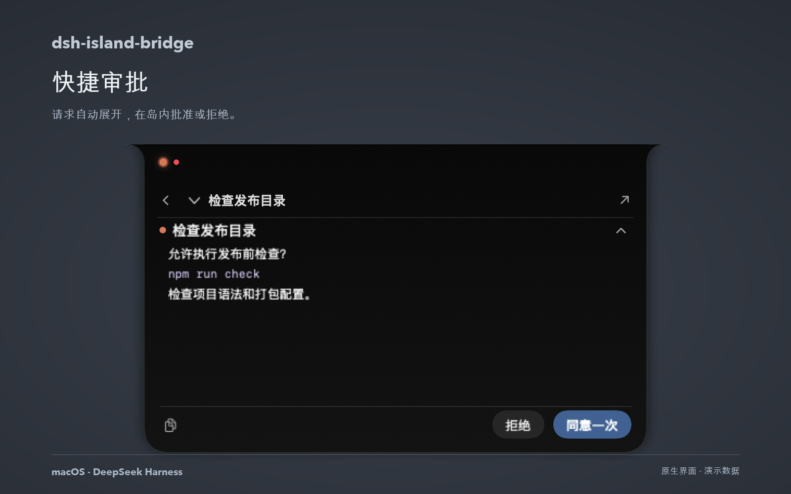

# dsh-island-bridge

让 DeepSeek Harness 的会话、交付通知和审批出现在 macOS 灵动岛上。

## 能做什么

- **最近会话** — 最多显示 3 条会话，查看活跃时间、累计 Token 和上下文占用。
- **阅读与回复** — 在岛内切换会话、滚动浏览 Markdown 历史；工具过程默认折叠。
- **交付通知** — 任务结束自动展开，红点标记未读；点击对应会话后清除。
- **快捷审批** — 审批和确认请求自动展开，可批准、拒绝或提交回答。

点击消息旁的箭头可回到 DSH 查看原对话。普通回复进入该会话的消息队列。

## 安装

需要 macOS 14+、DeepSeek Harness 桌面端及 Xcode Command Line Tools。

先安装编译工具（已安装可跳过）：

    xcode-select --install

在 DSH 插件管理中使用 GitHub 源地址：

    github:yinany79-alt/dsh-island-bridge

也可以通过终端安装到桌面 profile：

    dsh plugin --profile desktop add github:yinany79-alt/dsh-island-bridge

重启 DSH。首次启用时会在本机编译 Swift 原生面板。

## 使用

点击左侧鲸形波纹展开，选择会话进入详情。左上角返回，点击会话标题可快速切换；鼠标滚轮向上浏览更早消息。Esc 返回列表，再按一次收起。

列表的 token 表示会话累计用量（含缓存）。上下文百分比表示当前占用；缺少上报数据时省略。

| 最近会话 | 对话历史 |
| --- | --- |
|  |  |

| 交付通知 | 快捷审批 |
| --- | --- |
|  |  |

截图与动图使用公开示例会话和演示用量。

## 说明

- 本版本在 Apple Silicon、DSH 0.2.2-rc.3 上开发验证，Intel 与其他版本仍需验证。
- 会话内容经本机 stdio 和 DSH 同源接口传递。审批沿用 DSH 原有请求和权限语义。
- 未读状态在原生 helper 本次运行期间保存。长消息、附件和完整工具输出可在 DSH 中查看。
- 请停用其他版本的 dsh-island-bridge 后启用本版本，避免同时显示两个面板。

## 开发

Node.js 22+ 和 Swift 工具链：

    npm run check
    npm run build:helper

lib/ 负责 DSH 桥接，helper/island-helper.swift 负责原生界面。项目使用 [MIT 许可证](LICENSE)，基于 [JiayangSUNwinter/dsh-island-bridge](https://github.com/JiayangSUNwinter/dsh-island-bridge) 二次开发，保留原作者版权。
